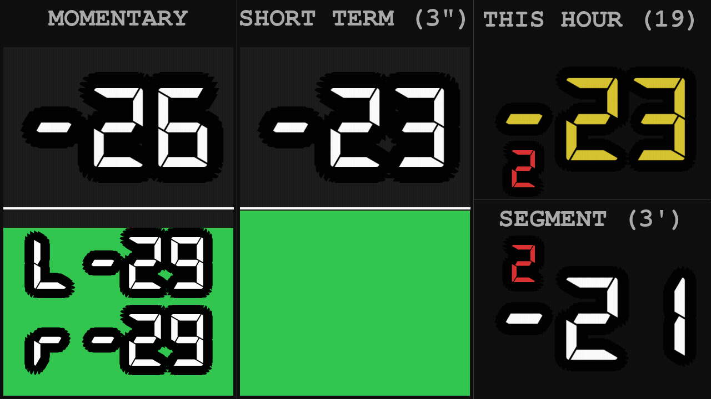
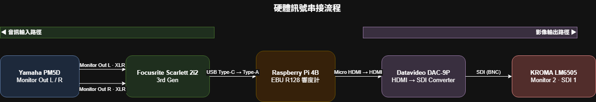
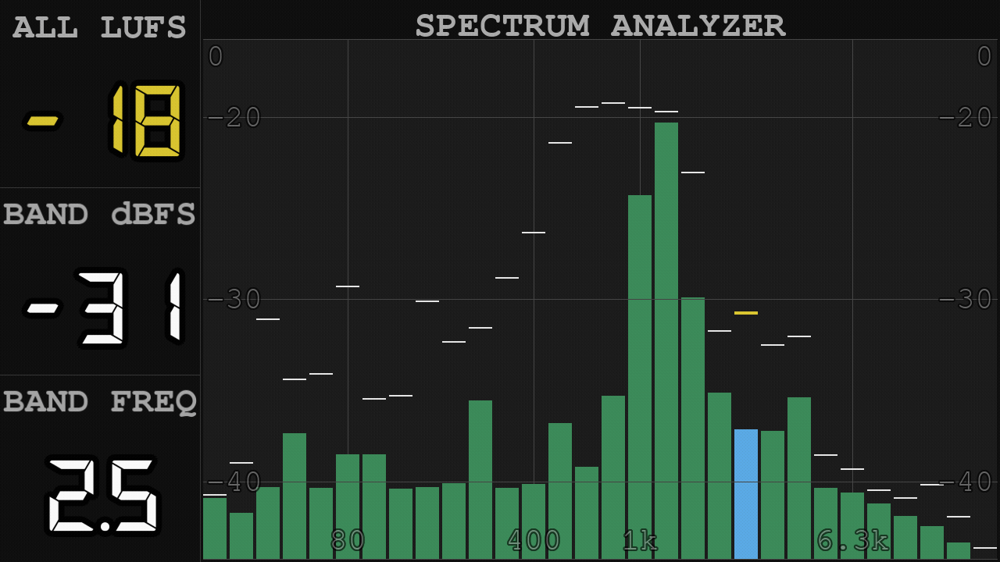
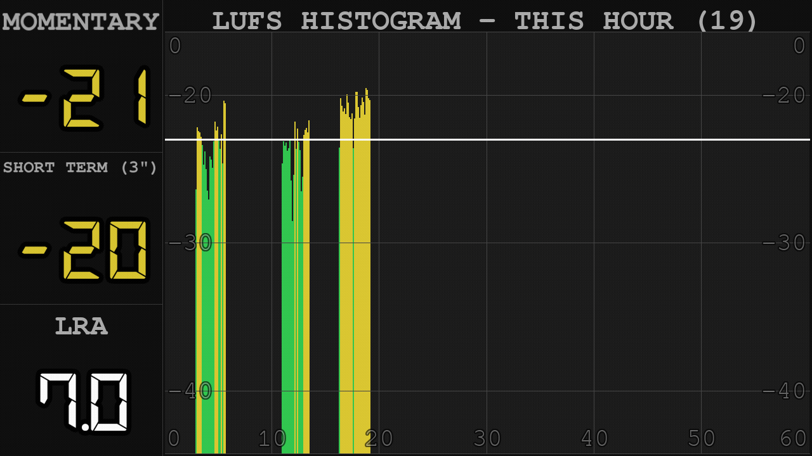

# 樹莓派多功能 Meter

[](https://github.com/AzureRush/lufsmeterforpi)
[](https://hackmd.io/@penomadd/RasberryPi4B_LUFSMeter?view)





用一台 Raspberry Pi 做成的**聲音大小監看儀表**：接上混音台的訊號後，在螢幕上即時告訴你「現在聲音有多大聲、這一小時平均多大聲、最近哪裡太大聲或太小聲」，補上混音台只有 Peak Meter[^peak] 時看不到的資訊，讓控音更有依據。

量測方法符合廣播響度標準 EBU R128 / ITU-R BS.1770-5[^std]。共有三個畫面，用混音台上的按鍵就能切換，不需要鍵盤滑鼠：

| 畫面 | 一句話說明 |
|------|-----------|
| **畫面一：Loudness Meter（響度計）** | 平常監看用：現在、最近 3 秒、這一小時、最近 3 分鐘各有多大聲 |
| **畫面二：Spectrum Analyzer（頻譜）** | 找問題頻率用：聲音裡低音、中音、高音各佔多少 |
| **畫面三：Histogram（響度歷史）** | 回頭看用：這一小時（或最近 3 分鐘）的音量起伏，一根一根排成時間軸 |

---

## 更新記錄

### 2026-10-09
- 修好偶發的「掉音訊」：原因是畫面上每出現一個沒見過的數字，就要花約 30 毫秒現場畫一張大字，期間會擋住收音。改成開機時先把所有數字的每個字元都畫好，執行中不再現場畫字（實測一次從約 27 ms 降到約 3.6 ms），記憶體也不再一路長大
- Spectrum／Histogram 的刻度文字放大、加黑色描邊與半透明；Spectrum 下方加上頻率標示（80 / 400 / 1k / 6.3k）與垂直輔助線
- Spectrum 的高點標示停留時間由 1 秒改為 3 秒；目前選定的頻段，它的高點標示改成黃色加粗
- Histogram 下方不再另留一列文字，圖的高度與 Spectrum 完全一致，兩個畫面的刻度位置對得上

### 2026-10-03
- Loudness 畫面更新頻率由每秒 20 次降為 10 次（數據本來就是每秒算 10 次），並拿掉 SHORT TERM 與 SEGMENT 下方的小歷史色塊（歷史改看畫面三）。這個畫面的 CPU 使用率由 59.6% 降為 46.9%
- Histogram 的「最近」模式改為 3 分鐘、固定 60 根，每根剛好 3 秒

### 2026-09-19
- 新增**畫面三：Histogram（響度歷史）**
- THIS HOUR / SEGMENT 的計算改由 Rust 模組 `lufs_core` 負責[^rust]，消除以往每小時接近整點時越來越嚴重的掉音訊（舊版每小時約 800 次 → 0 次）
- THIS HOUR / SEGMENT 的計算門檻修正為現行標準值 −10 LU[^gate]（舊程式用的是 2011 年以前的舊值 −8）。一般節目幾乎不受影響，動態很大的內容數值會略低，最多約 0.5

### 2026-08-15
- 新增 **Spectrum Analyzer**（頻譜分析儀）第二畫面：GPIO 觸發切換、1/3 Octave 長條圖
- 長條圖新增 Peak hold（頂住 1 秒後緩慢回落），左側 BAND dBFS 讀值改沿用同一份數值，不再逐幀跳動
- BAND dBFS 校準修正：改為左右聲道各自算功率再取平均，避免聲道相位不同時互相抵消
- 曾加入步進式帶通濾波器＋耳機監聽輸出，但實機測試發現約 100ms 延遲疊加現場 main out 喇叭造成明顯回音，改回 Scarlett 硬體 Direct Monitor（Pi 不再輸出任何音訊，純視覺化診斷）
- 左側資訊欄改名（MOMENTARY → ALL LUFS、F.F.dBFS → BAND dBFS、F.FREQ → BAND FREQ），反映拔除濾波器後的語意

### 2026-05-20
- THIS HOUR 大數字顏色跟隨 LUFS 值變化（藍／綠／黃／紅），與 meter bar 一致

### 2026-05-19
- 數字描邊加粗，視覺更清晰
- SEGMENT 面板的 delta 值移至區塊左上角顯示
- 更新截圖與預覽 GIF

### 2026-05-16
- 顯示架構遷移至 KMS + Wayland，告別舊有 X11 環境
- 字型大小改為依解析度自動縮放
- CPU 使用率從 ~200% 降至 ~63%，溫度從 ~80°C 降至 ~61°C

---

## 系統軟硬體

| 元件 | 規格 |
|------|------|
| 主機 | Raspberry Pi 4B |
| 作業系統 | Raspberry Pi OS Trixie（Debian 13）64-bit |
| 音訊介面 | Focusrite Scarlett 2i2 3rd Gen（USB Type-C → Type-A） |
| 音源輸入 | Yamaha PM5D Monitor Out L / R（XLR 類比）→ Scarlett 2i2 |
| 影像輸出 | Micro HDMI(Pi Out) → (optional)Datavideo DAC-9P（HDMI→SDI）→ (optional)KROMA LM6505 SDI 1 |
| 顯示架構 | KMS（`vc4-kms-v3d`）+ Wayland（labwc）+ SDL2 Wayland driver |
| 解析度 | 720p 60Hz（由 `install.sh` 寫入 kanshi 設定，開機自動套用；字型大小自動適應） |
| 電源 | 建議使用官方 5.1V / 3A 電源與短而粗的 USB-C 線（見「已知限制」） |

除了 Raspberry Pi 以外的設備應都可自行更換並適應。

---

## 系統訊號串接



---

## 安裝（新的一台 Pi）

**需要**：Raspberry Pi 4（或更新）、**64-bit Raspberry Pi OS 桌面版**（Desktop，用 Raspberry Pi Imager 燒錄；Lite 版沒有桌面，不能用）、安裝時能上網。

```bash
git clone https://github.com/AzureRush/lufsmeterforpi.git ~/loudness_meter
cd ~/loudness_meter
bash install.sh
sudo reboot
```

重開機後會自動進桌面、自動啟動響度計，整個流程約 15 分鐘（多半是下載套件）。`install.sh` 做的事：

| 步驟 | 內容 |
|------|------|
| 檢查 | 64-bit、桌面版、Python 3.8 以上 |
| 系統套件 | GPIO（gpiozero、lgpio）、收音（PortAudio）、螢幕設定（kanshi、wlr-randr）、截圖（grim） |
| Python 環境 | 在專案資料夾建 `venv/`，裝 `requirements.txt`（固定版本）與 `wheels/` 裡的 Rust 模組 `lufs_core`[^rust] |
| 權限 | 把使用者加進 gpio、audio 群組 |
| 螢幕解析度 | 寫入 `~/.config/kanshi/config`（預設 720p，開機自動套用；要別的解析度：`LM_RESOLUTION=1920x1080@60Hz bash install.sh`） |
| 開機自動啟動 | 寫入 `~/.config/autostart/loudness_meter.desktop`（不影響桌面與工作列） |

重複執行 `install.sh` 是安全的（例如更新程式之後重跑一次）。

> 不需要在 Pi 上安裝 Rust：`wheels/` 裡已經放了編好的模組。修改 `lufs_core/` 的 Rust 程式碼後，要在電腦上重新編譯並更新 `wheels/` 裡的檔案（`maturin build --release --target aarch64-unknown-linux-gnu --zig`）——**不要在 Pi 上編譯**，會吃滿 CPU 影響正在跑的響度計。

---

## 平常操作（啟動／重啟／看紀錄）

```bash
bash ~/loudness_meter/run.sh             # 啟動（已經在跑就不會重複開）
bash ~/loudness_meter/run.sh --restart   # 重啟（更新程式後用這個）
cat /tmp/lm.log                          # 執行紀錄
```

按 **ESC** 可在 Pi 本機退出。

**音訊介面**：程式會自動找 Focusrite Scarlett。用別的介面時，在 `~/.config/labwc/environment` 加一行指定裝置名稱的一部分，重開機生效：

```
LM_AUDIO_DEVICE=UMC
```

沒設定、也找不到 Scarlett 時：在終端機手動執行會列出所有輸入裝置讓你選；開機自動啟動（沒有鍵盤）時則自動選第一個雙聲道的輸入裝置，並在 `/tmp/lm.log` 記下選了哪一個。

> 字型大小依畫面寬度自動縮放（以 1920px 為基準）。啟動時會先花不到 1 秒把畫面上會用到的數字字元預先畫好，之後才開始收音。


---

## 操作（用混音台上的按鍵）

在 PM5D 面板的 **USER DEFINED KEYS（Bank A）** 按下對應按鍵即可操作：

| PM5D 按鍵 | 在 Loudness 畫面 | 在 Spectrum 畫面 | 在 Histogram 畫面 |
|-----------|-----------------|-----------------|-------------------|
| **KEY 9** | 切到 Spectrum | 切到 Histogram | 切回 Loudness |
| **KEY 10** | （不作用） | 選定的頻段往**低頻**移一格 | 在「這一小時」和「最近 3 分鐘」之間切換 |
| **KEY 11** | （不作用） | 選定的頻段往**高頻**移一格 | 同 KEY 10 |

- KEY 9 三個畫面依序循環。
- 在 Loudness 畫面按 KEY 10 / KEY 11 不會有任何反應，避免不小心誤觸。
- **切換畫面不會讓數據中斷**：背景計算一直在跑，切回來時 THIS HOUR、SEGMENT、歷史圖都是連續的。

### GPI 訊號對應

PM5D 端在 `GPI OUT` 設定畫面把三個 PORT 指定為 USER DEFINED KEYS，觸發模式 **UNLATCH**、極性 **Low Active**（GPO 為 open collector，觸發時拉低，與 Pi 端的內部上拉相符）：

| PM5D 按鍵 | GPO / PORT | D-sub 25 針腳 | Pi 實體排針 | BCM GPIO |
|-----------|-----------|---------------|-------------|----------|
| KEY 9 | GPO3 / PORT 3 | Pin 2 | Pin 11 | GPIO17 |
| KEY 10 | GPO5 / PORT 5 | Pin 3 | Pin 13 | GPIO27 |
| KEY 11 | GPO12 / PORT 12 | Pin 13 | Pin 15 | GPIO22 |
| （共用接地） | — | Pin 6 | Pin 9 | GND |

三組訊號共用同一條地線即可（觸發電流為微安等級，無串擾疑慮）。Pi 端所需的四支排針剛好相鄰（Pin 9 / 11 / 13 / 15），接線時不易數錯。

> ⚠️ **D-sub 25 的 Pin 9 是 +5V，絕對不要接到 Pi 的任何 GPIO** — Pi 的 GPIO 只接受 3.3V，接上 5V 會燒毀。本專案不需要這條線。（注意別和上表 Pi 端的「實體 Pin 9＝GND」混淆，兩者是不同接頭上的編號。）

### 遠端觸發（不用碰實體按鍵）

程式另外註冊了三個對應的系統訊號，SSH 連上後可直接觸發，方便遠端展示、錄製畫面或除錯：

```bash
kill -HUP  <PID>   # 等同 KEY 9（切換畫面）
kill -USR1 <PID>   # 等同 KEY 11
kill -USR2 <PID>   # 等同 KEY 10
```

---

## 畫面一：Loudness Meter（響度計）


平常監看用的主畫面，分成三欄，數字單位都是 LUFS[^lufs]（數字越接近 0 越大聲，−23 是廣播的目標值）：

| 位置 | 名稱 | 看什麼 |
|------|------|--------|
| 左欄 | **MOMENTARY** | **現在這一瞬間**有多大聲（約 0.4 秒內的平均），反應最快。下方 `L` / `R` 是左右聲道各自的數值，可以看出兩邊是否平衡 |
| 中欄 | **SHORT TERM (3")** | **最近 3 秒**平均有多大聲。比 MOMENTARY 穩定，比較適合判斷「這一段整體是不是太大聲」 |
| 右上 | **THIS HOUR** | **這一小時到現在**的整體響度，括號內是目前小時（例如 `THIS HOUR (17)`），整點自動歸零重算。安靜、沒聲音的片段不會把數字拉低[^gating] |
| 右下 | **SEGMENT (3')** | **最近 3 分鐘**的整體響度，大約等於一則新聞（稿頭＋新聞帶約 2~3 分鐘）的長度，不用手動標記開頭結尾 |

**大數字旁的小數字（變化量）**
- THIS HOUR 旁：跟**上一個小時**比，差多少
- SEGMENT 旁：跟**3 分鐘前**比，差多少
- 紅色＝比較大聲、綠色＝比較小聲、灰色 0＝一樣

**長條（MOMENTARY / SHORT TERM）與顏色**

長條高度跟著音量上下跳動，白色橫線是目標值 −23。顏色代表音量區間（THIS HOUR 的數字顏色也照這個規則）：

| 顏色 | 範圍 | 意思 |
|------|------|------|
| 藍色 | 小於 −30 | 偏小聲 |
| 綠色 | −30 ~ −23 | 在目標值以下、合理範圍 |
| 黃色 | −23 ~ −10 | 超過目標值 |
| 紅色 | 大於 −10 | 太大聲 |

---

## 畫面二：Spectrum Analyzer（頻譜分析儀）



### 用途

把聲音拆成 30 個頻段（從最低音 25 Hz 到最高音 20 kHz），每一根長條代表一個頻段有多大聲。用來**找出特別刺耳、轟轟作響或想消除的頻率**。

Pi 只負責「看」，不輸出任何聲音——找到問題頻段後，實際的 EQ 修正在混音台上做。

### 怎麼看

- **長條**：越高代表那個頻段越大聲。下方標了幾個參考位置：**80**（低音）、**400**（中低音）、**1k**（人聲附近）、**6.3k**（高音／齒音）
- **長條上方的細線**：最近碰過的最高點（Peak hold）。碰到新高點後**停留 3 秒**，之後慢慢往下掉，方便你看清楚剛剛衝多高
- **藍色長條＋黃色粗線**：目前選定的頻段，以及它的最高點
- **左右兩側的數字**：刻度（0、−20、−30、−40），單位 dBFS[^dbfs]，越接近 0 越大聲；圖的最底部代表 −70。中間 −20 ~ −40 這段放大顯示，因為一般節目訊號大多落在這裡

### 左欄

| 區塊 | 看什麼 |
|------|--------|
| **ALL LUFS** | 整體聲音現在有多大聲（跟畫面一的 MOMENTARY 是同一個數字） |
| **BAND dBFS** | 目前選定頻段的最高點數值（就是黃色粗線的位置） |
| **BAND FREQ** | 目前選定的頻率。1000 以上不顯示 k，例如 `1.25` 代表 1.25 kHz、`1` 代表 1 kHz |

### 選頻段

用 KEY 10 / KEY 11 一格一格移動。移到最後一個頻段的下一格會顯示 `ALL`（不選定任何頻段），再按就繞回最前面——就算其中一顆按鍵壞了，只按另一顆也能走到每一格。**選頻段只改變顯示，不會影響聲音。**

---

## 畫面三：Histogram（響度歷史）



### 用途

把過去一段時間的音量，**按時間順序一根一根排開**：左邊是比較早、右邊是最新。一眼就能看出哪一段太大聲、哪一段太小聲、整體有沒有貼著目標值。

### 兩種範圍（KEY 10 / KEY 11 切換）

| 模式 | 標題 | 橫軸 | 每一根代表 |
|------|------|------|-----------|
| **這一小時** | `THIS HOUR (17)` | 整點起 0 ~ 60 分，從左往右長滿，整點後清空重來 | 約 7 秒 |
| **最近 3 分鐘** | `SLIDING (3')` | 3 分鐘前 → 現在（`3'` `2'` `1'` `now`），每 3 秒往左捲一格 | 3 秒（共 60 根） |

### 怎麼看

- **每根長條的高度**：那段時間裡 SHORT TERM 的**最高值**（取最高而不是平均，才不會把突然的爆音藏起來）
- **長條顏色**：跟畫面一的顏色規則一樣（藍／綠／黃／紅）
- **白色橫線**：目標值 −23
- **刻度**：跟畫面二完全相同的位置與間距，兩個畫面可以直接對照

### 左欄

| 區塊 | 看什麼 |
|------|--------|
| **MOMENTARY** | 現在這一瞬間有多大聲（同畫面一） |
| **SHORT TERM (3")** | 最近 3 秒有多大聲（同畫面一） |
| **LRA** | 這段時間**音量起伏有多大**[^lra]（範圍跟著上面的模式：這一小時／最近 3 分鐘） |

**LRA 怎麼解讀**：數字越小，音量越平穩；數字越大，忽大忽小的落差越大。
- 大約 5 以下：很平穩，像廣告、新聞播報
- 大約 15 以上：起伏很大，像電影、戲劇、音樂會
- 剛整點、或資料不到 1 分鐘時顯示 `---`；只有幾分鐘的資料時數字容易偏高，參考就好

---

## 技術架構

音訊為**單工輸入**（`sd.InputStream`），程式不輸出任何音訊。核心是三條執行緒分工，讓音訊 callback 維持輕量、不過載：

```
音訊 callback（PortAudio RT thread，每 50ms 一個 block）
  → H / SEG：有狀態 K-weighting，能量 push 進 Rust 的 EnergyStore
              （濾波器狀態須跨 block 連續，只能在此執行）
  → M / S  ：raw audio chunk 寫入 deque，交由 compute_loop 處理

compute_loop（daemon thread，10Hz）— 三個畫面下都持續運行
  → M / S  ：對 raw audio 做無狀態 K-weighting → mean-square → LUFS
  → H / SEG：每秒一次，Rust lufs_core 做 two-stage gating（運算時釋放 GIL）
  → Histogram：每秒記一筆 S（時間, 值），LRA 由這份序列計算

pygame main thread（依畫面：Loudness 10fps／Spectrum 20fps／Histogram 5fps）
  → Loudness 畫面：讀取 latest dict → 渲染三面板
  → Spectrum 畫面：對 buf_s_chunks 尾端取樣做 FFT → 分頻段 → 渲染長條圖
  → Histogram 畫面：時間序列分欄（欄內取最大）→ 渲染時間軸長條圖
```

### 為什麼要用 Rust 算 THIS HOUR / SEGMENT

Python 的多條執行緒同一時間只能有一條在跑（GIL）。舊版 THIS HOUR 每次都要把整小時的資料（最多 72000 筆）轉換一次，越接近整點越久，期間收音的 callback 被擋住，就會漏掉聲音（input overflow）。改由 Rust 保管資料、在不佔用 GIL 的情況下計算後，整點前的漏音由每小時約 800 次降為 0。

### 大數字的繪製方式

大數字有黑色描邊，畫一張要約 30 ms，所以必須快取。以前是「整串數字」快取（例如 `-24`），每出現沒見過的數字就要現場畫，這段時間會擋住收音，造成偶發漏音，快取也會一直變大。現在改成兩層：

1. **字元層**：每個字元（0–9、`-`、`.` 等）各色只畫一次，開機時預先畫好、張數固定
2. **整串層**：最近用過的 48 串數字拼好備用；遇到新數字時只用現成字元拼圖（約 3.6 ms），不必現場描邊

### 計算方法

**響度（Loudness Meter）**

| 指標 | 方法 | 窗口 |
|------|------|------|
| M | K-weighted mean-square，無 gating（符合 R128） | 400ms 滑動 |
| S | K-weighted mean-square，無 gating（符合 R128） | 3s 滑動 |
| H | EBU R128 two-stage gating（絕對 −70 LUFS、相對 −10 LU），Rust `lufs_core` | 整點起累積 |
| SEG | 同 H | 3 分鐘滑動 |
| L/R | K-weighted mean-square per channel | 400ms 滑動 |
| LRA | EBU Tech 3342：S 序列套絕對 −70 與相對 −20 LU 門檻後，取第 95 與第 10 百分位之差 | 同 Histogram 模式 |

**頻譜（Spectrum Analyzer）**

| 項目 | 方法 |
|------|------|
| FFT | 8192 samples（~171ms @ 48kHz，解析度 ~5.9Hz）＋ Hann window |
| 聲道合併 | 左右聲道**各自**做 FFT 算功率後取平均——不可先在時域平均兩聲道再做 FFT，兩聲道相位不一致時會互相抵消（實測曾造成 ~30dB 誤差） |
| 頻段能量 | 頻段內 bin **加總**（非平均），符合 RTA 慣例 |
| dBFS 校準 | 以 Parseval 能量守恆推導校準基準（`N × Σwindow² / 4`），滿刻度正弦波準確讀出 0dBFS；已用合成訊號驗證誤差 <0.01dB |
| Peak hold | 碰到新高點立即跟上並頂住 3 秒，之後以 12dB/秒回落；BAND dBFS 讀值直接沿用此值 |

### 顯示刻度（非線性）

把畫面高度集中配置在訊號實際常駐的區間：

```
Loudness Meter（LUFS）        Spectrum / Histogram（dBFS / LUFS，兩個畫面共用）
−60 ~ −40 → 下方 20% 空間      −70 ~ −40 → 下方 15% 空間
−40 ~   0 → 上方 80% 空間      −40 ~ −20 → 中段 70% 空間 ← 訊號常駐區
                               −20 ~   0 → 上方 15% 空間
```

---

## 設定

`loudness_meter.py` 頂部可調整：

```python
# ── 音訊 / 響度 ──
SAMPLE_RATE      = 48000
BLOCK_SIZE       = 2400     # 50ms per block
M_BLOCKS         = 8        # 瞬時窗口 = 8 × 50ms = 400ms
S_BLOCKS         = 60       # 短期窗口 = 60 × 50ms = 3s
TARGET_LUFS      = -23.0    # 目標線位置（LUFS）
RELATIVE_GATE_LU = 10.0     # THIS HOUR / SEGMENT 的相對門檻（BS.1770-5 標準值）

# ── 畫面更新率（每秒幾次） ──
_SCREEN_FPS = {"loudness": 10, "spectrum": 20, "histogram": 5}

# ── GPIO 腳位（BCM 編號）──
GPIO_PIN_TOGGLE    = 17   # 實體 Pin 11，畫面切換
GPIO_PIN_FREQ_PREV = 27   # 實體 Pin 13，上一個頻率
GPIO_PIN_FREQ_NEXT = 22   # 實體 Pin 15，下一個頻率

# ── Spectrum Analyzer ──
SPECTRUM_FFT_SIZE     = 8192    # FFT 視窗大小
_PEAK_HOLD_SEC        = 3.0     # 高點標示停留時間（秒）
_PEAK_DECAY_PER_SEC   = 12.0    # 停留後的回落速度（dB/秒）

# ── Histogram ──
_TL_SLIDE_BIN = 3.0   # 「最近」模式每根代表幾秒
_TL_SLIDE_N   = 60    # 「最近」模式共幾根（3 秒 × 60 = 3 分鐘）
```

Scarlett 裝置 index 由程式自動偵測，不需手動設定。

---

## 已知限制

* SEGMENT 為近似段落監看，無法精確對齊新聞帶頭尾
* **Pi 不輸出任何音訊**：耳機監聽需靠音訊介面本身的 Direct Monitor（或混音台送出）。曾實作過 Pi 端帶通濾波器＋耳機監聽輸出，但 USB 來回約 100ms 的延遲疊加現場 main out 喇叭會產生明顯回音感，實測不堪用而移除（程式碼保留在 git 歷史中）
* 安裝時需要網路（apt 與 pip 下載套件）；現場沒有網路的話，要先在有網路的地方裝好再帶過去
* 只支援 64-bit Raspberry Pi OS 桌面版（Rust 模組只編了 64-bit 版、畫面需要 labwc 桌面）
* 所有操作依賴外部設備的 GPI 訊號，沒有鍵盤／觸控的備援介面；遠端可用系統訊號觸發（見「操作」章節）
* **Pi 的時鐘沒有自動校時**（現場沒有網路，Pi 也沒有內建電池時鐘），每天大約快 0.5 分鐘。THIS HOUR 的整點歸零與 Histogram 的「這一小時」都跟著 Pi 的時鐘走
* **電源餘裕不大**：響度計單獨運作時正常，但同時跑其他吃 CPU 的工作（例如遠端測試、連續截圖）時，曾出現短暫的電壓不足（Under-voltage）。建議使用官方 5.1V / 3A 電源與短而粗的 USB-C 線
* Histogram 的資料只存在記憶體，響度計重新啟動後會從空白開始
* LRA 用的 S 序列約每秒一筆（EBU Tech 3342 要求每秒至少 10 筆），實測與每秒 10 筆的結果差距在 0.1 LU 左右，遠小於標準容許的 ±1 LU
* KROMA LM6505 有點毛病，單一 Monitor 雖有 SDI1/2 但若頻率無對齊就會出現握手問題，若發生無法握手則拔掉無法對齊的訊源並重開 KROMA LM6505
* 用 `install.sh` 安裝的會由 kanshi 在開機時自動套用 720p；本專案目前這台正式機是在安裝腳本之前手動設定的，重開機後要手動執行一次 `wlr-randr`（或補跑 install.sh 的解析度步驟）

---

## 參考(References)

* [ITU-R BS.1770-5（2023）Algorithms to measure audio programme loudness and true-peak audio level](https://www.itu.int/rec/R-REC-BS.1770/en)
* [EBU R 128 Loudness normalisation and permitted maximum level of audio signals](https://tech.ebu.ch/publications/r128)
* [EBU Tech 3342 Loudness Range: A measure to supplement EBU R 128 loudness normalization](https://tech.ebu.ch/publications/tech3342)
* https://github.com/csteinmetz1/pyloudnorm
* [pyloudnorm: A simple yet flexible loudness meter in Python](https://csteinmetz1.github.io/pyloudnorm-eval/paper/pyloudnorm_preprint.pdf)
* [DSEG Font](https://github.com/keshikan/DSEG)

---

## 名詞備註

[^peak]: **Peak Meter（峰值表）**：顯示訊號瞬間的最高電平，用來防止爆音（clipping），但無法反映人耳感覺到的「整體有多大聲」。響度表（Loudness Meter）則依人耳聽感加權後計算，兩者用途不同。
[^std]: **EBU R128 / ITU-R BS.1770-5**：歐洲廣播聯盟（EBU）與國際電信聯盟（ITU）制定的廣播響度標準。BS.1770 定義「怎麼算響度」，R128 定義「節目要多大聲（−23 LUFS）」。本專案依 BS.1770-5（2023 現行版）。
[^lufs]: **LUFS（Loudness Units relative to Full Scale）**：響度單位，以數位滿刻度為 0，數字都是負的，越接近 0 越大聲。1 LU 的差距約等於 1 dB。計算時先套用 K-weighting（模擬人耳對低頻較不敏感、對 2kHz 以上較敏感的濾波），再算能量平均。
[^gating]: **Gating（門檻篩選）**：THIS HOUR 與 SEGMENT 計算時會先排除太小聲的片段——低於 −70 LUFS 的（絕對門檻），以及比整體平均再低 10 LU 以上的（相對門檻）——所以停頓、靜音不會把數字拉低。MOMENTARY 與 SHORT TERM 依標準不做 gating。
[^gate]: **相對門檻 −10 LU**：ITU-R BS.1770-2（2011）起的標準值；2011 年以前的版本是 −8 LU。
[^rust]: **Rust / `lufs_core`**：Rust 是一種執行效率高的程式語言。`lufs_core` 是本專案用 Rust 寫的計算模組（以 PyO3 包成 Python 可呼叫的套件），負責保管每 50ms 一筆的能量資料並計算 THIS HOUR / SEGMENT，計算時不佔用 Python 的 GIL。
[^dbfs]: **dBFS（decibels relative to Full Scale）**：數位訊號的電平單位，0 dBFS 是數位系統能表示的最大值（再大就破音），所以數字都是負的。頻譜畫面的數值已校準：混音台送出 −20 dBFS 的測試音，畫面就讀到 −20。
[^lra]: **LRA（Loudness Range，響度範圍）**：EBU Tech 3342 定義的指標，單位 LU。把 SHORT TERM 的歷史數值排序，先去掉靜音與背景雜音，再去掉最小聲的 10% 與最大聲的 5%，剩下的最大與最小之差就是 LRA——所以片尾淡出或單一聲爆音都不會讓它失真。EBU R128 只把它當參考資訊，沒有規定上限。EBU 的測試範例：廣告類約 5、電影戲劇類約 15。
