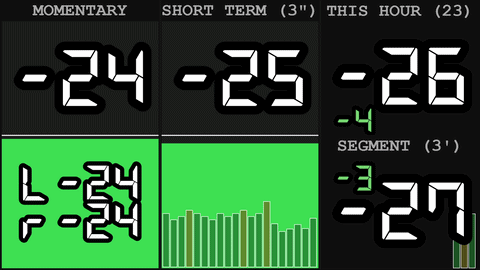
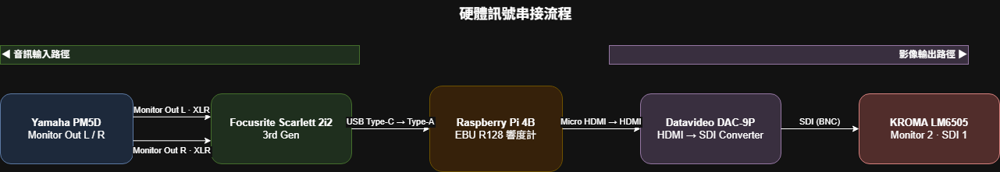
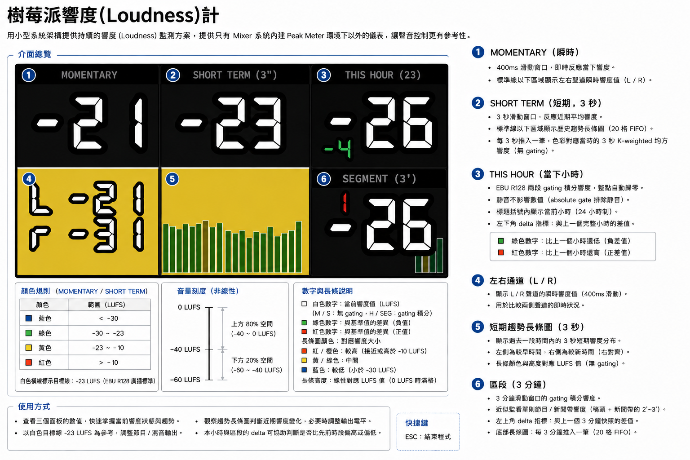
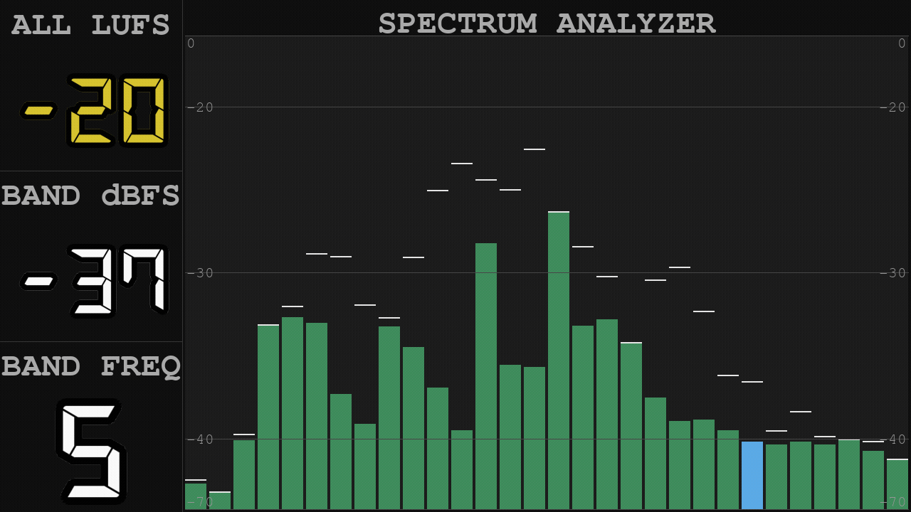

# 樹莓派響度計

[](https://github.com/AzureRush/lufsmeterforpi)
[](https://hackmd.io/@penomadd/RasberryPi4B_LUFSMeter?view)




用小型系統架構提供持續的響度(Loudness)監測方案，提供只有 Mixer 系統內建 Peak Meter 環境下以外的儀表，讓聲音控制更有參考性。

本系統是在 Raspberry Pi 4B 上，以 python 為架構運行的即時 LUFS 監看工具，符合 EBU R128 / ITU-R BS.1770-4 廣播標準。另備有 **Spectrum Analyzer**（1/3 Octave 即時頻譜）作為第二畫面，可用外部設備的 GPI 訊號直接切換，不需鍵盤滑鼠。

---

## 更新記錄

### 2026-08-15
- 新增 **Spectrum Analyzer**（頻譜分析儀）第二畫面：GPIO 觸發切換、1/3 Octave 長條圖
- 長條圖新增 Peak hold（頂住 1 秒後緩慢回落），左側 BAND dBFS 讀值改沿用同一份數值，不再逐幀跳動
- BAND dBFS 校準修正：改為左右聲道各自算功率再取平均，避免聲道相位不同時互相抵消
- 曾加入步進式帶通濾波器＋耳機監聽輸出，但實機測試發現~100ms 延遲疊加現場 main out 喇叭造成明顯回音，改回 Scarlett 硬體 Direct Monitor（Pi 不再輸出任何音訊，純視覺化診斷）
- 左側資訊欄改名（MOMENTARY → ALL LUFS、F.F.dBFS → BAND dBFS、F.FREQ → BAND FREQ），反映拔除濾波器後的語意

### 2026-05-20
- THIS HOUR 大數字顏色跟隨 LUFS 值變化（藍／綠／黃／紅），與 meter bar 一致

### 2026-05-19
- 數字描邊加粗，視覺更清晰
- SEGMENT 面板的 delta 值移至區塊左上角顯示，避免和 History 區塊的色塊重疊
- 更新截圖與預覽 GIF

### 2026-05-16
- 顯示架構遷移至 KMS + Wayland，告別舊有 X11 環境
- 字型大小改為依解析度自動縮放
- CPU 使用率從 ~200% 降至 ~63%，溫度從 ~80°C 降至 ~61°C

---

## 系統軟硬體

| 元件 | 規格 |
|------|------|
| 主機 | Raspberry Pi 4B |
| 作業系統 | Raspberry Pi OS Trixie（Debian 13）64-bit |
| 音訊介面 | Focusrite Scarlett 2i2 3rd Gen（USB Type-C → Type-A） |
| 音源輸入 | Yamaha PM5D Monitor Out L / R（XLR 類比）→ Scarlett 2i2 |
| 影像輸出 | Micro HDMI(Pi Out) → (optional)Datavideo DAC-9P（HDMI→SDI）→ (optional)KROMA LM6505 SDI 1 |
| 顯示架構 | KMS（`vc4-kms-v3d`）+ Wayland（labwc）+ SDL2 Wayland driver |
| 解析度 | 720p 60Hz（可透過 `wlr-randr` 調整，字型大小自動適應） |

除了 Raspberry Pi 以外的設備應都可自行更換並適應。

---

## 系統訊號串接



---

## 安裝

```bash
pip3 install sounddevice pygame scipy numpy gpiozero
```

---

## 執行

依顯示環境選擇對應的啟動方式：

**一般環境（有桌面 / Desktop OS）：**
```bash
DISPLAY=:0 python3 ~/loudness_meter/loudness_meter.py
```

**Pi OS Trixie + KMS/Wayland（本專案目前硬體配置）：**

Pi OS Trixie 啟用 KMS（`/boot/firmware/config.txt` 加入 `dtoverlay=vc4-kms-v3d`）後，系統會自動啟動 labwc Wayland compositor。直接以 Wayland driver 啟動，無需 X11：

```bash
# （選用）先確認解析度，視需要強制指定
XDG_RUNTIME_DIR=/run/user/1000 WAYLAND_DISPLAY=wayland-0 \
  wlr-randr --output HDMI-A-1 --mode 1280x720@60

# 啟動響度計
XDG_RUNTIME_DIR=/run/user/1000 WAYLAND_DISPLAY=wayland-0 SDL_VIDEODRIVER=wayland \
  ~/loudness_meter/venv/bin/python ~/loudness_meter/loudness_meter.py
```

> 字型大小依偵測到的畫面寬度自動縮放（以 1920px 為基準），支援任意解析度。

按 **ESC** 退出。

---

程式啟動時會自動偵測 Focusrite Scarlett，無需手動設定 device index。
若未偵測到 Scarlett，會列出所有可用輸入裝置並提示選擇：

```
Scarlett not found. Available input devices:
  1. USB Audio Device: Audio (hw:2,0)  (ch: 2)
  2. Built-in Audio: Audio (hw:0,0)   (ch: 2)

Select device [1-2]: _
```

輸入對應編號即可繼續執行，支援任何 ALSA 可識別的 USB 音訊介面。

---

## 操作（GPI 控制）

本系統有**兩個畫面**，用外部設備（本專案為 Yamaha PM5D）透過 GPI OUT 送觸發訊號到 Pi 的 GPIO 切換，不需要額外接鍵盤滑鼠或觸控螢幕：

| 畫面 | 內容 |
|------|------|
| 畫面一：Loudness Meter | EBU R128 響度監看（M / S / THIS HOUR / SEGMENT） |
| 畫面二：Spectrum Analyzer | 1/3 Octave 即時頻譜 |

### 操作按鍵

在 PM5D 面板的 **USER DEFINED KEYS（Bank A）** 按下對應按鍵即可操作：

| PM5D 按鍵 | 功能 | 行為 | 生效畫面 |
|-----------|------|------|----------|
| **KEY 9** | 畫面切換 | 兩個畫面來回切換 | 兩個畫面皆可 |
| **KEY 10** | 上一個頻率 | Spectrum 畫面上反白的頻段往**低頻**移動一格 | 僅 Spectrum 畫面 |
| **KEY 11** | 下一個頻率 | Spectrum 畫面上反白的頻段往**高頻**移動一格 | 僅 Spectrum 畫面 |

KEY 10 / KEY 11 在 Loudness 畫面按下會被忽略，避免誤觸改動狀態。

> **切換畫面不會中斷背景運算**：響度計算執行緒持續在跑，THIS HOUR / SEGMENT / 歷史色塊都照常累積，切回 Loudness 畫面時數據不會斷一截。

### GPI 訊號對應

PM5D 端在 `GPI OUT` 設定畫面把三個 PORT 指定為 USER DEFINED KEYS，觸發模式 **UNLATCH**、極性 **Low Active**（GPO 為 open collector，觸發時拉低，與 Pi 端的內部上拉相符）：

| PM5D 按鍵 | GPO / PORT | D-sub 25 針腳 | Pi 實體排針 | BCM GPIO |
|-----------|-----------|---------------|-------------|----------|
| KEY 9 | GPO3 / PORT 3 | Pin 2 | Pin 11 | GPIO17 |
| KEY 10 | GPO5 / PORT 5 | Pin 3 | Pin 13 | GPIO27 |
| KEY 11 | GPO12 / PORT 12 | Pin 13 | Pin 15 | GPIO22 |
| （共用接地） | — | Pin 6 | Pin 9 | GND |

三組訊號共用同一條地線即可（觸發電流為微安等級，無串擾疑慮）。Pi 端所需的四支排針剛好相鄰（Pin 9 / 11 / 13 / 15），接線時不易數錯。

> ⚠️ **D-sub 25 的 Pin 9 是 +5V，絕對不要接到 Pi 的任何 GPIO** — Pi 的 GPIO 只接受 3.3V，接上 5V 會燒毀。本專案不需要這條線。（注意別和上表 Pi 端的「實體 Pin 9＝GND」混淆，兩者是不同接頭上的編號。）

### 遠端觸發（不用碰實體按鍵）

程式另外註冊了三個對應的系統訊號，SSH 連上後可直接觸發，方便遠端展示、錄製畫面或除錯：

```bash
kill -HUP  <PID>   # 畫面切換
kill -USR1 <PID>   # 下一個頻率
kill -USR2 <PID>   # 上一個頻率
```


---

## 畫面一：Loudness Meter（響度計）



平常監看用的主畫面，分為三個垂直面板：

### MOMENTARY（瞬時）

* 400ms 滑動窗口，即時反應當下響度
* meter 色塊 顯示當前響度
* 標準線以下區域顯示 **L / R 個別聲道響度值**（格式：`L -26` / `R -26`）

### SHORT TERM( 3")（短期）

* 3 秒滑動窗口，反應近期平均響度
* meter 色塊 顯示近期平均響度
* 標準線以下區域顯示 **20 格歷史色塊**：每 3 秒推入一筆，右對齊 FIFO（先進先出），色彩對應當時的 3 秒 K-weighted 均方響度（無 gating）；高度線性對應 LUFS 值（0 LUFS 時滿格、頂至標準線，−41 LUFS 時為空）；若佔滿 Short Term 區塊，最左側即是 1分鐘前 的響度。

### THIS HOUR / SEGMENT（第三面板，僅顯示數字）

#### 上半區塊 : THIS HOUR（當下小時)

* EBU R128 兩段 gating 積分響度，整點自動歸零
* 靜音不影響數值（符合 EBU R128 規範，absolute gate 排除靜音）
* 標題括號內顯示當前小時（如 `THIS HOUR (9)`），整點自動更新
* 左下角顯示 **delta 指標**：與上一個完整小時的差值（紅色 = 比上一個小時還高，綠色 = 比上一個小時還低）

#### 下半區塊 : SEGMENT( 3')

* 3 分鐘滑動窗口的 gating 積分響度
* 設計用途：新聞播出時近似監看單則新聞帶響度（稿頭 + 新聞帶 約 2'~3'）
* 無須手動標記段落頭尾，滑動窗口隨時反映最近 3 分鐘的整體響度
* 左上角顯示 **delta 指標**：與上一個 3 分鐘 gating 積分響度快照的差值（紅色 = 比上一個 3 分鐘還高，綠色 = 比上一個 3 分鐘還低）
* 底部顯示 **20 格歷史色塊**：每 3 分鐘推入一筆，右對齊 FIFO（先進先出），色彩對應當時的 3 分鐘 gating 積分響度；若佔滿 Segment 區塊，最左側即是 1小時前 的響度。

### 顏色規則（MOMENTARY / SHORT TERM）

| 顏色 | 範圍 |
|------|------|
| 藍色 | < −30 LUFS |
| 綠色 | −30 ~ −23 LUFS |
| 黃色 | −23 ~ −10 LUFS |
| 紅色 | > −10 LUFS |

白色橫線標示 **−23 LUFS** 目標值（EBU R128 廣播標準）。

---

## 畫面二：Spectrum Analyzer（頻譜分析儀）



### 用途

即時 1/3 Octave 頻譜視覺化，用來找特別刺耳或想消除的頻率。Pi 純粹是視覺診斷工具、不輸出任何音訊——實際掃頻監聽交給混音台自己的 EQ 搭配耳機/喇叭聽，找到問題頻段後也是在混音台上做 EQ 修正，不在 Pi 上處理。

### 頻段選擇

用 PM5D 的 **KEY 10 / KEY 11** 移動反白的頻段，左側 BAND dBFS / BAND FREQ 讀值跟著更新。**這只是顯示狀態，不影響任何音訊。**

* 走到清單邊界會 **wraparound** 繞到另一頭——萬一其中一顆鍵故障，另一顆單獨連續按繞一圈仍能到達所有頻段，不會有走不到的死角
* 頻率清單最後多一格 `ALL`，代表「不選定特定頻段」（BAND dBFS 顯示 `---`、長條圖不反白任何一條）

### 畫面配置

左側 W/5 資訊欄（由上而下）：

| 區塊 | 內容 |
|------|------|
| ALL LUFS | 全頻率／寬頻瞬時響度（LUFS），跟 Loudness Meter 的 MOMENTARY 同一份數值，顏色規則相同 |
| BAND dBFS | 目前選定頻段的校準後 dBFS 讀值（真正的數位滿刻度校準，不是相對值），顯示的是該頻段的 Peak hold 值（見下方），不是逐幀跳動的瞬時值 |
| BAND FREQ | 目前選定的頻率 |

右側是 30 條 1/3 Octave 長條圖（IEC 61260 / ANSI S1.11 標準頻段中心頻率），藍色代表目前選定的頻段。每根長條上方有一條白色細線標示 **Peak hold**：碰到新高點後頂住 1 秒，之後以 12dB/秒緩慢回落——BAND dBFS 數字讀值直接沿用這條線的數值，不再逐幀跳動。長條圖左右兩側都畫有 dBFS 刻度線，範圍依實測校準（-70 ~ -40dBFS 與 -20 ~ 0dBFS 兩端壓縮，-40 ~ -20dBFS 訊號常駐區給最多畫面空間）。

---

## 技術架構

音訊為**單工輸入**（`sd.InputStream`），程式不輸出任何音訊。核心是三條執行緒分工，讓音訊 callback 維持輕量、不過載：

```
音訊 callback（PortAudio RT thread，每 50ms 一個 block）
  → H / SEG：有狀態 K-weighting，energy 直接寫入 deque
              （濾波器狀態須跨 block 連續，只能在此執行）
  → M / S  ：raw audio chunk 寫入 deque，交由 compute_loop 處理

compute_loop（daemon thread，10Hz）— 兩個畫面下都持續運行
  → M / S  ：對 raw audio 做無狀態 K-weighting → mean-square → LUFS
  → H / SEG：對預存 energy 套用自製 EBU R128 two-stage gating

pygame main thread（20fps）
  → Loudness 畫面：讀取 latest dict → 渲染三面板
  → Spectrum 畫面：對 buf_s_chunks 尾端取樣做 FFT → 分頻段 → 渲染長條圖
                   （毫秒級運算，直接內嵌在 frame 預算內，不另開執行緒）
```


### 計算方法

**響度（Loudness Meter）**

| 指標 | 方法 | 窗口 |
|------|------|------|
| M | K-weighted mean-square，無 gating（符合 R128） | 400ms 滑動 |
| S | K-weighted mean-square，無 gating（符合 R128） | 3s 滑動 |
| H | 自製 EBU R128 two-stage gating | 整點起累積 |
| SEG | 同 H | 3 分鐘滑動 |
| L/R | K-weighted mean-square per channel | 400ms 滑動 |

**頻譜（Spectrum Analyzer）**

| 項目 | 方法 |
|------|------|
| FFT | 8192 samples（~171ms @ 48kHz，解析度 ~5.9Hz）＋ Hann window |
| 聲道合併 | 左右聲道**各自**做 FFT 算功率後取平均——不可先在時域平均兩聲道再做 FFT，兩聲道相位不一致時會互相抵消（實測曾造成 ~30dB 誤差） |
| 頻段能量 | 頻段內 bin **加總**（非平均），符合 RTA 慣例；平均會把窄頻測試音的能量稀釋到頻段內的空 bin 裡 |
| dBFS 校準 | 以 Parseval 能量守恆推導校準基準（`N × Σwindow² / 4`），滿刻度正弦波準確讀出 0dBFS；已用合成訊號驗證誤差 <0.01dB |
| Peak hold | 碰到新高點立即跟上並頂住 1 秒，之後以 12dB/秒回落；BAND dBFS 讀值直接沿用此值 |

### 顯示刻度（非線性）

兩個畫面各自有一條刻度曲線，把畫面高度集中配置在訊號實際常駐的區間：

```
Loudness Meter（LUFS）        Spectrum Analyzer（dBFS）
−60 ~ −40 → 下方 20% 空間      −70 ~ −40 → 下方 15% 空間
−40 ~   0 → 上方 80% 空間      −40 ~ −20 → 中段 70% 空間 ← 訊號常駐區
                               −20 ~   0 → 上方 15% 空間
```

Spectrum 的 Y 軸刻度線與長條高度使用同一條曲線計算，所以刻度間距本身就是非等距的。

---

## 設定

`loudness_meter.py` 頂部可調整：

```python
# ── 音訊 / 響度 ──
SAMPLE_RATE = 48000
BLOCK_SIZE  = 2400     # 50ms per block
M_BLOCKS    = 8        # 瞬時窗口 = 8 × 50ms = 400ms
S_BLOCKS    = 60       # 短期窗口 = 60 × 50ms = 3s
TARGET_LUFS = -23.0    # 目標線位置（LUFS）
FPS         = 20       # 畫面更新率

# ── GPIO 腳位（BCM 編號）──
GPIO_PIN_TOGGLE    = 17   # 實體 Pin 11，畫面切換
GPIO_PIN_FREQ_PREV = 27   # 實體 Pin 13，上一個頻率
GPIO_PIN_FREQ_NEXT = 22   # 實體 Pin 15，下一個頻率

# ── Spectrum Analyzer ──
SPECTRUM_FFT_SIZE     = 8192    # FFT 視窗大小
_PEAK_HOLD_SEC        = 1.0     # peak 頂住不落下的時間（秒）
_PEAK_DECAY_PER_SEC   = 12.0    # 頂住時間過後的回落速度（dB/秒）
_SPECTRUM_DBFS_LO     = -70.0   # 長條圖底部
_SPECTRUM_DBFS_HI     = 0.0     # 長條圖頂部（0dBFS = 數位滿刻度）
```

Scarlett 裝置 index 由程式自動偵測，不需手動設定。

---

## 已知限制

* SEGMENT 為近似段落監看，無法精確對齊新聞帶頭尾
* **Pi 不輸出任何音訊**：耳機監聽需靠音訊介面本身的 Direct Monitor（或混音台送出）。曾實作過 Pi 端帶通濾波器＋耳機監聽輸出，但 USB 來回約 100ms 的延遲疊加現場 main out 喇叭會產生明顯回音感，實測不堪用而移除（程式碼保留在 git 歷史中，日後若有低延遲方案可回頭套用）
* Spectrum Analyzer 依賴外部設備的 GPI 訊號操作，沒有鍵盤/觸控的備援介面；遠端可用系統訊號觸發（見「操作」章節）
* KROMA LM6505 有點毛病，單一 Monitor 雖有 SDI1/2 但若頻率無對齊就會出現握手問題，若發生無法握手則拔掉無法對齊的訊源並重開 KROMA LM6505。
* Pi OS Trixie + KMS 環境下，解析度由 labwc Wayland compositor 依 EDID 自動協商，若需固定解析度須在每次開機後手動執行 `wlr-randr`（尚未設定開機自動套用）

---

## 參考(References)

* https://github.com/csteinmetz1/pyloudnorm
* [pyloudnorm: A simple yet flexible loudness meter in Python](https://csteinmetz1.github.io/pyloudnorm-eval/paper/pyloudnorm_preprint.pdf)
* [ITU-R Algorithms to measure audio programme loudness and true-peak audio level](http://magnetic.beep.pl/Loudness/2016/R-REC-BS.1770-4-201510.pdf)
* [DSEG Font](https://github.com/keshikan/DSEG)
